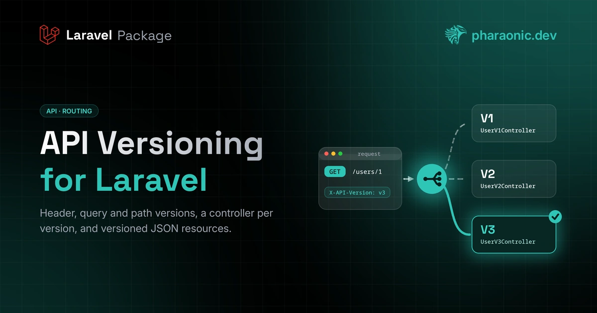

<p align="center"><a href="https://pharaonic.dev/packages/laravel/api-versioning" target="_blank"></a></p>

<p align="center">
  <a href="https://php.net" target="_blank"></a>
  <a href="https://laravel.com" target="_blank"></a>
  
  
  <br>
  <a href="https://packagist.org/packages/Pharaonic/laravel-api-versioning" target="_blank"></a>
  <a href="https://packagist.org/packages/pharaonic/laravel-api-versioning" target="_blank"></a>
  <a href="https://packagist.org/packages/pharaonic/laravel-api-versioning" target="_blank"></a>
</p>

<h3 align="center">Laravel-native API versioning: version groups and constraints on Route, header, query and path resolution, version-specific controllers, and versioned JSON resources.</h3>
<br>

## Installation

```bash
composer require pharaonic/laravel-api-versioning
```

The service provider is registered automatically. Publish the configuration when you need to change it:

```bash
php artisan vendor:publish --tag=api-versioning-config
```

## Usage

```php
// config/pharaonic/api-versioning.php: 'versions' => ['v1', 'v2'],

Route::get('users', 'UserController@index')->controllers([
    'v1' => 'UserV1Controller@index',
    'v2' => 'UserV2Controller@index',
]);

Route::get('reports', 'ReportController@index')->sinceVersion('v2');
```

`GET /users` with `X-API-Version: v2` runs `UserV2Controller@index`, with its middleware, bindings and policies. No URL prefix is added unless you configure one.

## Documentation

Full documentation: [API Versioning Documentation](https://pharaonic.dev/packages/laravel/api-versioning).

## Support & Security

See [SUPPORT.md](SUPPORT.md) and [SECURITY.md](SECURITY.md). Contributions are welcome; see [CONTRIBUTING.md](CONTRIBUTING.md).

## License

MIT. See [LICENSE](LICENSE).
